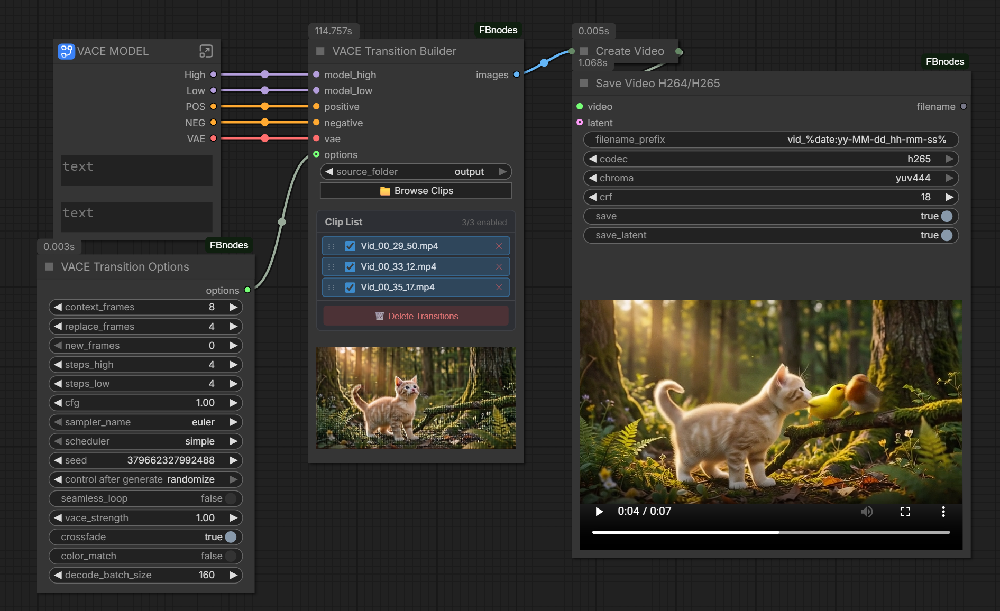

# ComfyUI-FBnodes

A grab bag of handy ComfyUI nodes I built for my own workflows and figured someone else might enjoy too. Video saving, universal switches, LoRA helpers, animated latent previews, Crop tool and whatever else I end up needing next.

## Nodes

### Save Video+
Save video with workflow metadata, date-token filenames and a player on the node. Settings sit under **Options**.

- **Encoding: auto** (default): saves with ComfyUI's own encoder, keeping the incoming video's settings from Create Video (bit depth, HDR / HDR PQ, chroma, H.264 / AV1 / ProRes). An already encoded video is copied, not re-encoded; unencoded frames get H.264, 4:2:0, CRF 16
- **Encoding: custom**: H.264 (8-bit) or H.265/HEVC (10-bit), yuv420 / yuv422 / yuv444 and CRF
- **Preview mode**: Save off writes a quick preview to temp; a video that is already browser-playable is shown as it is, without encoding
- **Browser preview**: clips the browser cannot play get an H.264 preview copy, or a still frame with an "open in system player" button
- **Latent saving**: Optionally save the latent alongside the video for easy re-generation
- **Filename tokens**: `%yy%` `%year%` `%month%` `%day%` `%hour%` `%minute%` `%second%`, `%width%` `%height%`, `%time%` (seconds the run took); the (i) beside Filename lists them

### Save Image+
Save images with date-token filenames, output/temp switching, an optional Compare image input and an optional review before saving. Settings sit under **Options**.

- **PNG**: 8-bit (default) or 16-bit, sRGB input
- **EXR**: 16-bit or 32-bit float; sRGB, HDR (HLG), or linear input. Files are stored scene-linear.
- **AVIF**: Auto, 8-bit YUV420, or 10-bit YUV420; sRGB, HDR (HLG), or HDR PQ input, with CRF quality control. Saves one still image per batch item; RGBA inputs have alpha stripped for saving and preview, without compositing.
- **Review**: the run pauses and the images fill the screen; click the ones to keep and Send (Skip, or Send with none picked, keeps none). When the timer runs out every image is saved; picking pauses it
- **Compare**: hover the preview to wipe between the image and the Compare input; a grid shows a whole batch
- **Filename tokens**: same as Save Video+
- **Metadata**: Uses ComfyUI's advanced image encoders and metadata writers for the new formats. Requires a ComfyUI version with Save Image (Advanced); the original 8-bit PNG path remains available on older versions.
- **Preview**: EXR and AVIF use separate 8-bit PNG input-tensor previews in temp. These are not color-managed HDR previews and do not alter the saved files.
- **EXR workflow import**: Drop an EXR containing `workflow` or `prompt` header metadata onto ComfyUI to restore it through the normal JSON importer. FBnodes adds this reader because the core file-drop metadata reader does not currently handle EXR.

### Load Image+:
- **Image/Video Screenshot Loading**: Image loader, based on Prompt Extractor from [Prompt Manager](https://github.com/FranckyB/ComfyUI-Prompt-Manager)
- **Input/Output Folder Switching**: Toggle between browsing your input or output folder directly from the node
- **File Browser**: Same thumbnail browser as Prompt Extractor with subfolder navigation
- **Previous / Next**: ‹ › beside Source, or ← / → with the pointer over the node
- **Video Frame Picking**: Load any frame of a video, frame-exact (the frame shown is the frame loaded)
- **Drag-and-Drop / Paste**: Drop or paste images or videos onto the node
- **Large Preview**: Full-screen preview; ‹ › (and ← / → on pictures) step through the folder
- **Mask Painting**: Paint masks directly in-node; they show live in the preview
- **Crop + Flip**: In-node crop with an aspect ratio that can be locked (Free, Source or a fixed ratio), exact pixel values, plus Flip X / Flip Y
- **Slide and centre**: In Exact crop and Exact pad, drag a row's Left · Right or Top · Bottom label to slide the crop (or the canvas) along that axis, or press its centre button
- **Pad**: The `canvas` output extends the picture for outpainting by dragging any edge outward, moving the canvas around the picture, or typing exact pixels; an aspect ratio can be locked. Same output as core Pad Image for Outpainting: the new area is gray, and the MASK marks it, fading into the picture over the feather (shown on the preview), joined with any painted mask
- **IMAGE + MASK Output**: Outputs both IMAGE and MASK tensors, with alpha channel extraction from images

### Load Video+
Video loader with the same file browser and UX as Load Image+, but for videos. Outputs a VIDEO type for use with **Get Video Components+**.

- **Input/Output Folder Switching**: Toggle between browsing your input or output folder
- **File Browser**: Thumbnail browser with video-first filtering and subfolder navigation
- **Previous / Next**: ‹ › beside Source, or ← / → with the pointer over the node
- **Trim**: Edit > Trim loads only frames In to Out (both included), frame-exact; the stage shows the exact edge frame while you move it
- **Large Preview**: Full-screen player; ‹ › step through the folder. Videos the browser cannot play show their first frame and open in the system player
- **Drag-and-Drop Support**: Drop video files directly onto the node
- **VIDEO Output**: Outputs a VIDEO, ready to pipe into Get Video Components+

### Load Audio+
Audio loader with the same file browser and UX as Load Image+/Video+, plus in/out trimming.

- **Input/Output Folder Switching**: Toggle between browsing your input or output folder
- **File Browser**: Thumbnail browser with audio-first filtering and subfolder navigation
- **Drag-and-Drop Support**: Drop audio files directly onto the node
- **Previous / Next**: ‹ › beside Source, or ← / → with the pointer over the node
- **Trim**: Edit > Trim shows draggable in/out handles on the waveform and In / Out fields; playback loops inside the clip
- **Outputs**: `AUDIO` (trimmed) and `duration` (seconds)

### Video Review
Review gate for 2-pass video workflows (formerly LTX Review). It pauses the run, decodes the video/audio latents into a review clip and shows it full screen; the run goes on only when you proceed (or the timeout action says so).

- **Node**: Review (on, or pass through without decoding), FPS of the review clip, Timeout (0 = wait until you decide) and what happens when it runs out (proceed or cancel)
- **Review screen**: the clip fills the screen; Proceed, Cancel and Requeue in the panel beside it, with a countdown you can pause. <kbd>Space</kbd> plays / pauses, <kbd>←</kbd> <kbd>→</kbd> step a frame, <kbd>Enter</kbd> proceeds
- **Outputs**: `video_latent`, `audio_latent` (unchanged) and `video`: the review clip. Plug it into **Save Video+** with Save off to show it on the canvas (no re-encode). It is a quick H.264 copy, so save final videos from the latents. Nothing comes out of `video` when Review is off.

LTX Review Preview is now legacy: use Save Video+ on the `video` output instead.

### Load Checkpoint+
Checkpoint loader with a searchable, grouped dropdown designed for large model libraries.

- **Text filter**: Supports comma-separated terms (example: `sdxl, anime`)
- **AND matching**: All typed terms must match in model name or path
- **Grouped list UI**: Displays a flat list with section headers (example: `----Anime----`)
- **Clean labels**: Hides common extensions in the dropdown display (`.safetensors`, `.ckpt`, `.pt`, `.bin`, `.pth`)
- **Safe header selection**: Selecting a section header auto-selects the first model in that section
- **Real path output**: Node still passes the real Comfy model path internally
- **Outputs**: `MODEL`, `CLIP`, `VAE`, `ckpt_name` (COMBO)

### Load Diffusion Model+
Diffusion/UNET loader with the same searchable grouped dropdown UX as Load Checkpoint+.

- **Text filter**: Supports comma-separated terms (example: `flux, fp8, wan, low`)
- **AND matching**: All typed terms must match in model name or path
- **Grouped list UI**: Displays a flat list with section headers (example: `----Wan22----`)
- **Clean labels**: Hides common extensions in the dropdown display (`.safetensors`, `.ckpt`, `.pt`, `.bin`, `.pth`)
- **Safe header selection**: Selecting a section header auto-selects the first model in that section
- **Real path output**: Node still passes the real Comfy model path internally
- **Outputs**: `MODEL`, `unet_name` (COMBO)

### Load LoRA+
LoRA loader/applier with the same searchable grouped dropdown UX as the other Load Model+ nodes.

- **Text filter**: Supports comma-separated terms (example: `ltx, turbo`)
- **AND matching**: All typed terms must match in LoRA name or path
- **Grouped list UI**: Displays a flat list with section headers
- **Clean labels**: Hides common extensions in the dropdown display (`.safetensors`, `.ckpt`, `.pt`, `.bin`, `.pth`)
- **Apply strength**: `strength_model` controls how strongly the selected LoRA is applied to connected `MODEL`
- **Selector mode**: Works without a connected model and still outputs selected `lora_name` for downstream nodes
- **Real path output**: Node still resolves and uses the real Comfy LoRA path internally when applying
- **Outputs**: `model`, `lora_name` (COMBO)

### Visual LoRA Picker+
Pick LoRAs by thumbnail image instead of scrolling through filenames.

- **Image browser**: Opens a thumbnail file browser pointing at your LoRA folder; shows matching images (`webp`, `jpg`, `png`) that share the same path/name as the LoRA
- **LoRA resolution**: Selecting an image resolves the corresponding `.safetensors` LoRA automatically
- **Stack friendly**: Accepts an incoming `LORA_STACK` and appends the picked LoRA, or returns a single-entry stack
- **Numeric strength**: Quick numeric input sets both model and clip strength
- **Outputs**: `LORA_STACK` containing the picked `(path, model_strength, clip_strength)` tuple

### Crop Image+
Interactive crop node with draggable crop box, optional aspect-ratio lock, and live preview.

- **Interactive crop UI**: Drag the crop box and handles directly in-node
- **Aspect ratio lock**: Includes ratio presets with landscape toggle
- **Auto reset on new image**: New input image resets crop to full frame and ratio to `None`
- **Dual output**: Crops both IMAGE and MASK outputs together

### Clip Stitcher
Merge multiple video clips into one with optional cross-dissolve transitions. Pure blending, no generation.

- **File browser**: Multi-select clips from input/output or anywhere on disk; remembers last browsed folder
- **Reorderable clip list**: Drag-to-reorder, enable/disable individual clips, hover to preview
- **Clip duration**: Force fixed segment lengths — useful when source clips vary in length. Clip 0 plays `0 → clip_duration`; each later clip overlaps the previous by `blend_duration` (e.g. 5s duration + 1s blend = segments start at 0, 4, 9, 14…). Short clips are padded with black
- **Blend duration**: Seconds of cross-dissolve between clips (0 = hard cut). Audio is crossfaded to match
- **Output**: 10-bit VIDEO via ComfyUI's CreateVideo

### Crop Audio+ (legacy)
Trim an incoming AUDIO connection between in/out points. Kept for older workflows: use the core **Trim Audio Duration** node, or the Trim switch on Load Audio+ / Load Video+ for files.

- **Inputs**: `audio`, `in_point`, `out_point` (seconds; 0 = full length)
- **Outputs**: `audio` (trimmed), `duration` (trimmed length in seconds)


### VACE Stitcher
Generate smooth AI-powered transitions between video clips using VACE conditioning and 2-stage sampling with a single node featuring a built-in clip browser, drag-to-reorder list, and cached .latent transitions for resumability.

- **File browser modal**: Browse input/output folders, multi-select clips, subfolder navigation
- **Reorderable clip list**: Drag-to-reorder, enable/disable individual clips, hover thumbnails
- **2-stage sampling**: High-noise + low-noise models for quality transitions
- **Pixel-space stitching**: Crossfade with easing curves, optional color matching
- **Lossless latent support**: Load `.latent` clips directly — skips lossy video decode, with memory-efficient on-demand decoding
- **Cached transitions**: Transitions cached as lossless `.latent` files — skip already-generated pairs on re-run
- **Options node**: Connect a separate "VACE Stitcher Options" node to tune all parameters, or use sensible defaults

Inspired by [__Bob__](https://civitai.com/user/__Bob__)'s [Wan VACE Clip Joiner workflow](https://civitai.com/models/2024299/wan-vace-clip-joiner-smooth-ai-video-transitions-for-wan-ltx-2-hunyuan-and-any-other-video-source) on CivitAI.

[](docs/vace_stitcher.png)

<details>
<summary><strong>How to use VACE Stitcher</strong></summary>

An example workflow can be found ....  If starting from scratch here are some basic instructions.

#### Required Models

You need **both** the high-noise and low-noise Wan 2.2 VACE models. Choose one format:

**bf16 or fp8** (from Comfy-Org):
- [`wan2.2_vace_i2v_high_noise_14B-*.safetensors`](https://huggingface.co/Comfy-Org/Wan_2.2_ComfyUI_Repackaged/tree/main/split_files/diffusion_models)

or **GGUF** (from QuantStack):
- [`Wan2.2-VACE-Fun-A14B-*.gguf`](https://huggingface.co/QuantStack/Wan2.2-VACE-Fun-A14B-GGUF/tree/main) (high + low noise variants)

Place models in `/models/diffusion_models/` or `/models/unet` if GGUF

#### Tips

- Use a Wan 2.2 i2v‑distilled LoRA to lower the required step count.
- **Lossless clips**: Save your source clips with **Save Video+** using the "Save Latent" option. VACE Stitcher will automatically detect and use the `.latent` file for lossless quality — no video decode needed. A magenta dot in the clip list indicates which clips have a latent available. For now only Wan latents are supported.
- **First run** generates and caches all transitions. Subsequent runs skip cached pairs.
- **Delete Transitions** clears the cache so you can regenerate with different settings.
- Without an **Options** node connected, the seed is random each run — just delete transitions and re-queue for a new result.
- Connect a **VACE Stitcher Options** node to control context/replace frames, steps, sampler, crossfade, color matching, and more. Color matching needs the optional `color-matcher` package (`pip install color-matcher`); without it, it is skipped with a warning.
- Disable clips in the list (uncheck) to skip them without removing.

</details>

### Load Latent File
Load a `.latent` file saved by Save Video+, LTX audio/video latents included (Load LTX Latent File is now legacy). Companion node for video+latent workflows.

### Get Video Components+
Memory-efficient video inspector/extractor for VIDEO inputs.

- Metadata-first by default (does not decode frames/audio/latent unless those outputs are connected)
- Internal chunked frame decoding uses a fixed chunk size of 128 to reduce memory needs.
- Outputs: `images`, `audio`, `fps`, `filepath`, `latent`, `width`, `height`, `frame_count`, `duration`
- Automatically loads matching `.latent` file if one exists beside the video

### Audio Mono to Stereo
Convert mono audio to stereo by duplicating the channel. Useful for video models that output mono audio.

### Switch Any
Universal switch with up to 10 named inputs. True lazy evaluation — only the selected input is evaluated. Other inputs are completely ignored by ComfyUI, with zero performance cost from inactive branches.

- Custom names via comma/semicolon-separated list
- Dynamic input count (1-10)
- Names display on input slots

### If/Else Switch+
Boolean switch — passes through `on_true` or `on_false` based on a condition toggle. Only the active branch is evaluated. Like the core If/Else Switch, plus a `bool` output passing the condition on.

- Uses a normal boolean `condition` input

### If Any
Returns a boolean based on whether an optional any-type input is truthy.

- Accepts any connected value on `value`
- Returns `false` for disconnected input, `None`, empty values, and `0`
- Returns `true` for truthy connected values
- Useful for checking whether an image, latent, text, or other value is present

### Apply LoRA+
Apply a LORA_STACK (list of LoRA tuples) to a model and optional CLIP. Works with Prompt Manager Advanced's LoRA stack output.

- **H3 AdaLN** (MiniMax-H3): when a LoRA and the checkpoint differ in form (dense / full vs pruned / curve), ComfyUI skips the LoRA's `adaln_proj` layers with ~51 `ERROR lora` lines. Turn this on to rebase them onto the checkpoint's form so they apply. The basis comes from an H3 checkpoint of the other form in `models/diffusion_models` (or an `h3_silu_temb_grid.safetensors`), cached in `models/h3_adaln`; without one, the layers are dropped quietly. Adapted from [ComfyUI-PlagueKind-Nodes](https://github.com/PlagueKind/ComfyUI-PlagueKind-Nodes)' H3 AdaLN LoRA Fix (MIT, see `py/h3_adaln/LICENSE`).

### LoRA List+
Build a reorderable, toggleable list of LoRAs for quick testing workflows.

- Browse folders and add `.safetensors` files from disk
- Enable/disable individual LoRAs and drag to reorder
- Outputs enabled entries as newline-separated full paths
- Also outputs `basenames` (filename-only, extension removed), one per line

### Show as Text
Display any input as text in-node, with values persisted in the workflow.

- Accepts any input type (`*`) and converts values to string internally
- Useful for inspecting intermediate values without extra conversion nodes
- Persists displayed text across workflow reloads and tab switching

### Outpaint H3 Prepare / H3 Anchor Latent / Stitch
Outpaint with MiniMax H3 Image next to the core **MiniMax H3 Image Conditioning**, which stays as it is:

1. **Load Image+** with **Pad** (or core Pad Image for Outpainting) makes the `mask` and `canvas`; they go to the same-named inputs of Outpaint H3 Prepare, which passes them on to the next two.
2. **Outpaint H3 Prepare** cuts the picture out of the canvas for the conditioning's `image_1`, so the model never sees the gray, and gives the canvas's `width` and `height` at the **Megapixels** you set (0 keeps the canvas's own) for the conditioning's width and height.
3. **Outpaint H3 Anchor Latent** sits between the conditioning and KSampler, on the model path after any LoRAs (`model`, `positive` and the conditioning's latent in; `model`, `positive`, `latent` out to KSampler, denoise 1.0, and `mask`, `canvas` on to Outpaint Stitch). The canvas is VAE-encoded at the latent's resolution (keeping the canvas's aspect) with the pad mask as noise mask. With MiniMax H3 Image, Picture 1's reference also becomes the picture alone, placed where it sits on the canvas, so the model continues it instead of zooming or copying it.
4. **Outpaint Stitch** takes the decoded image and puts it back on the canvas at full size with AusBoss's **blend in** seam: colour, tone and detail hand over from the result to your picture across its edge, and deeper in, the picture is yours bit for bit. **Tone match** (0 to 1) takes the result's tone drift off first, read from the strip of your picture the model repainted (it needs a feather).

**Qwen Image 2.1** needs only Load Image+ and Outpaint Stitch, with the Qwen Image 2.1 outpaint LoRA: Load Image+'s `canvas` (Pad on) is `image_1` of Text Encode Qwen Image 2.1 (VAE connected, `resolution` about 1024 or more), whose positive, negative and latent go straight to KSampler (denoise 1.0); the decoded image, Load Image+'s `mask` and `canvas` go to Outpaint Stitch (Tone match 1). Qwen places a canvas-sized reference on the output grid by itself, and the LoRA paints the gray.

Inspired by [ComfyUI-H3VideoOutpaint](https://github.com/TwoAbove/ComfyUI-H3VideoOutpaint) and the Outpaint Anchor / Prepare of [ComfyUI-Aitrepreneur-Image-Tools](https://github.com/aitrepreneur/ComfyUI-Aitrepreneur-Image-Tools) (MIT); the seam and Tone match are adapted from [ComfyUI-AusBoss](https://github.com/ausboss/ComfyUI-AusBoss)' Stitch Inpaint (MIT, see `py/blend_in/LICENSE`).

## Replace with …+
Right-click a core **Load Image**, **Load Video**, **Save Image** or **Save Video** node and pick **Replace with …+**: the FBnodes version takes its place with the same links, and the loaded file (or a filename prefix you changed) carried over.

## Missing Model Remap Tool
Adds a top-bar button in ComfyUI: **Remap Missing Models**.

When clicked, it scans the current graph and tries to remap missing model-like widget values.

Matching order:
1. Exact basename match (case-insensitive)
2. Precision-token equivalent fallback (fp8/fp16/bf16)
3. Version variations (v1.1, v1_2, v2)

Example:
- workflow value: `wan21.safetensors`
- local file exists as: `wan/wan21.safetensors`
- tool remaps node widget to: `wan/wan21.safetensors`

Supported categories in v1:
- checkpoints/unet
- loras
- text encoders/clip
- vae (including audio-vae related widget keys)
- controlnet
- upscale models (including latent upscale related widget keys)
- Power Lora Loader (rgthree)

Rules and limits:
- Exact filename match first (case-insensitive)
- If exact fails, tries precision-token equivalents (fp8/fp16/bf16)
- If duplicate basenames exist in a category, result is marked ambiguous and skipped
- Updates only the current in-memory graph (no workflow file overwrite)
- Rejects unsafe values (absolute paths or traversal-like paths)

## Animated Latent Preview
Provides animated video previews during KSampler execution for video models (Wan, LTX, MiniMax). Compatible with VideoHelperSuite — automatically defers if VHS is installed.

The preview shows a configurable leading slice of the video, re-decoded every sampling step so you watch that segment progressively sharpen as denoising progresses.

Enable in ComfyUI Settings: **FBnodes > Video Sampling > Animated Latent Preview**

### True-color preview injection (MiniMax / LTX / Krea2)
ComfyUI's latent previewer doesn't have a TAESD decoder mapped for some models, so they fall back to the lower-quality Latent2RGB approximation. FBnodes injects TAESD support for those models so they show true-color previews. You can toggle each model's injection or set a custom TAESD filename in ComfyUI Settings: **FBnodes > Preview Injection**

Download the TAESD file for each model you use and place it in `ComfyUI/models/vae_approx/`:

- **MiniMax H3** — [taeh3.safetensors](https://huggingface.co/Kijai/MiniMax-H3-TAE/tree/main/vae_approx)
- **LTX** — [taeltx2_3.safetensors](https://huggingface.co/Kijai/LTX2.3_comfy/tree/main/vae)
- **Krea2** — [TAE_Krea2_AcademiaSD.safetensors](https://huggingface.co/AcademiaSD/TAE-Krea-2)

Then refresh ComfyUI. If a file is missing, that model keeps the standard preview and a message with the download link is printed to the console.

For Krea2 image previews, enable **Display animated or subgraph previews when sampling** and use ComfyUI's **TAESD** or **Auto** preview method. Under **FBnodes > Preview Injection**, leave **Krea2 TAESD filename** blank for the default, or enter another compatible checkpoint's filename (including any subfolder under `models/vae_approx`). Krea2 injection does not change Wan previews. Restart ComfyUI after installing this extension update.

## Installation

### ComfyUI Manager
Search for "ComfyUI-FBnodes" in ComfyUI Manager.

### Manual
```bash
cd ComfyUI/custom_nodes
git clone https://github.com/FranckyB/ComfyUI-FBnodes.git
```

## Requirements
Nothing beyond ComfyUI itself (PyAV and SciPy come with it). Optional: `color-matcher` for VACE Stitcher's color matching.

## License
GPL-3.0

## Changelog

### version 1.6.0
- **New look**: The loaders, savers and Video Review are rebuilt as one card each in a shared visual language, in Classic and Nodes 2.0. Older workflows load unchanged
- **Load Image+ / Video+ / Audio+**: Previous / next file buttons and keys; Trim for video (frame-exact) and audio; full-screen preview that steps through the folder; frame-exact video frames in Load Image+
- **Save Image+**: Review before saving, Compare wipe and grid, date and time filename tokens
- **Save Video+**: Encoding auto keeps Create Video's settings; previews already playable videos without encoding
- **Video Review** (was LTX Review): full-screen review with a pausable timer; outputs the review clip as `video` (review_path removed)
- **Outpainting**: Pad in Load Image+, and Outpaint H3 Prepare / H3 Anchor Latent / Stitch for MiniMax H3 Image (Stitch also with Qwen Image 2.1)
- **If/Else Switch+** (was Switch Any Bool); **Replace with …+** on the right-click menu of core Load / Save Image and Video nodes
- **Legacy**: Crop Audio+ (use Trim Audio Duration), Load LTX Latent File (use Load Latent File), LTX Review Preview (use Save Video+)
- **Fixes**: Get Video Components+ follows a trimmed video and re-runs when an output is linked

### version 1.4.0
- **Load Model+**: Added Load Checkpoint, Diffusion model and LoRA with filtering system.  Allowing, for example, to display only SDXL models.
- **Bug Fixes**: Multiple big fixes added over time.  Including an issue with VACE Stitcher that would fail if clip size wasn't divisible by 32

### version 1.3.1
- **LoRA List+**: Utility node for testing LoRAs, allows adding LoRAs to a list from anywhere on disk. Used with Outputlists-Combiner

### version 1.3.0
- **Crop Image+**: Added a new interactive crop node.

### version 1.2.00
- **Repath Models**  Added a new repath utility.  Allowing for 1 click repathing of all models and loras.  Uses minimal fuzzy logic to find models with different quantizations or versions.
- **Show as Text**  Added a simple Show Text node, that unlike Preview  as Text, is saved with Workflow and is maintained when switching tabs.

### version 1.1.12
- **Load Audio+**: Added a load audio node, similar to other loaders.  Has the ability to trim the In and Out point.
- **Polish**:  Tweaked the UIs of Load Image+ and Load Video+, matching tweaks that were done to Load Audio+

### version 1.1.11
- **Apply LoRA+**: Added a simple "apply LoRA Stack" node, with a strength multiplier

### version 1.1.10
- **Load Image+ Mask Support**: Added MASK output with alpha channel extraction from images
- **Mask Editor Integration**: MaskEditor now works correctly — painted masks display in the node preview with transparency
- **Fix**: Handle MaskEditor's annotated filepath format (`file.png [input]`) so masked images load properly

### version 1.1.9
- **Renamed nodes**: cleaned up internal node IDs (`SaveVideoH26x` → `SaveVideoPlus`, `PromptApplyLora` → `ApplyLoraPlus`, `BetterImageLoader` → `LoadImagePlus`). Existing workflows will use "Legacy" versions for backward compatibility.
- **Fix Save Video+ display issues**: Fixed issues found in Load Video+.

### version 1.1.8
- **Speed Improvement**: Thumbnail generation now uses server-side PyAV instead of browser-based video decoding — substantially faster, especially with many clips.
- **Improved Handling of H265 Clips**
- **Renamed nodes**: Save Video H264/H265 → **Save Video+**, Better Image Loader → **Load Image+**. Existing workflows are unaffected.
- **New node**: Added **Load Video+** — video loader with file browser, preview, and drag-drop. Outputs VIDEO for Get Video Components+.

### version 1.1.5
- **VACE Stitcher**: Added lossless `.latent` file support for clips and transitions
  - Clips with a `.latent` file alongside are loaded in latent space, avoiding lossy video decode
  - Transitions now cached as `.latent` files instead of h265 video — lossless quality
  - Memory-efficient on-demand decoding: only decode what's needed, when it's needed
  - Latent indicator (magenta dot) in clip list UI shows which clips have `.latent` files

### version 1.1.1
- Renamed node from "VACE Transition Builder" to **VACE Stitcher**
- Added Workflow example.

### version 1.1.0
- Added **VACE Stitcher** node — generates smooth AI transitions between video clips using VACE conditioning
- Added **VACE Stitcher Options** node — optional parameter overrides for the stitcher
- Credit to [__Bob__](https://civitai.com/user/__Bob__) for the [original workflow](https://civitai.com/models/2024299/wan-vace-clip-joiner-smooth-ai-video-transitions-for-wan-ltx-2-hunyuan-and-any-other-video-source)

### version 1.0.0
- Initial release
- Transferred miscellaneous from [ComfyUI-Prompt-Manager](https://github.com/FranckyB/ComfyUI-Prompt-Manager) to keep it more focused.
